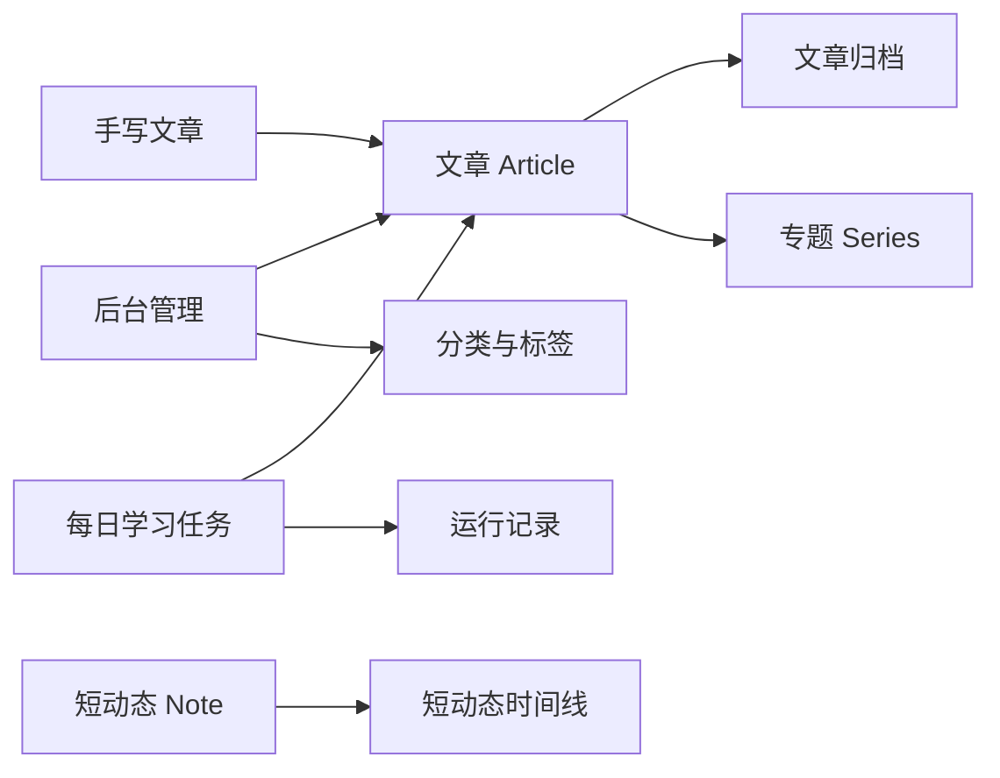

# 个人博客的内容模型怎么设计

我最开始把博客理解成一张文章表：标题、正文、分类、标签。这样做当然能跑起来，写到几十篇以后，问题也会慢慢出现。

一条刚想到的短句，和一篇完整的项目复盘，不应该挤在同一个入口里。几篇需要按顺序阅读的文章，也不适合只靠几个标签临时拼出来。每日问答还有定时任务、失败重试和发布记录，这些东西和手写文章的流程完全不同。

所以在这个项目里，我把内容拆成几种有不同节奏的对象：文章、专题、短动态和每日学习。分类与标签负责横向整理，文章和专题负责长期阅读，短动态负责把还没长成文章的想法先记录下来。

## 先按写作节奏拆内容

目前的划分大致是这样：

| 对象 | 适合放什么 | 主要阅读方式 |
| --- | --- | --- |
| 文章 | 技术实践、项目复盘、完整笔记 | 归档、搜索、分类、标签 |
| 专题 | 一组有顺序的文章 | 沿着上一篇和下一篇阅读 |
| 短动态 | 临时想法、开发进度、链接记录 | 按时间倒序浏览 |
| 每日学习 | 定时生成的问答或学习记录 | 按任务运行，再落成文章 |

这张表没有什么神秘的地方。它只是把“写多长”“要不要按顺序读”“是否需要自动生成”这几个问题先分开。内容一多，后面的接口和页面都会轻松一些。

## 文章是完整内容的落点

文章模型在 `backend/app/models/article.py` 里。正文使用 `content_markdown` 保存，标题、摘要、封面、作者、来源链接、发布时间和更新时间也都在这里。浏览量和点赞数同样跟着文章走。

分类和标签没有被塞进正文。文章有一个分类，可以挂多个标签；如果文章属于某个专题，还会保存 `series_id` 和专题内的 `series_order`。这样一篇文章可以同时出现在分类页、标签页和专题阅读里，正文只需要维护一份。

Markdown 是这里比较重要的选择。数据库保存原始 Markdown，前台再负责目录、代码高亮、图片和其他展示细节。编辑器换了，文章内容不用跟着改；搜索时也可以直接在标题、摘要和 Markdown 正文里查关键词。

当前项目没有单独的草稿状态。后台保存文章后，它就会进入文章归档。`published_at` 为空时，只代表这篇文章没有设置发表时间，不能把它当成“对外隐藏”。

这是一个有意的取舍。个人博客刚开始维护时，少一个状态就少一套筛选、预览和发布规则。如果以后需要草稿，应该增加明确的状态字段，同时检查归档、搜索、RSS、站点地图和每日学习的过滤逻辑。把“发表时间为空”临时当成草稿，后面很容易留下边界问题。

## 专题解决“按顺序读”的问题

专题本身不保存文章正文。它只有别名、标题、简介、封面和排序信息，文章通过 `series_id` 关联到专题，再用 `series_order` 决定顺序。

这让专题和分类各自承担一件事：

- 分类回答“这篇文章属于哪一类”。
- 专题回答“读完这篇之后该读哪篇”。

例如，一篇 FastAPI 文章可以归到“后端”，同时放进“个人博客重构”专题。分类适合筛选，专题适合连续阅读，它们不应该互相替代。

文章详情页会根据专题顺序提供上一篇和下一篇，也会给出相关推荐。删除专题时，系统只解除文章关联，不删除文章本身。专题是阅读组织方式，文章才是内容本体。

## 短动态给未完成的想法留个位置

短动态的模型比文章小很多：它只有稳定的 `slug`、Markdown 正文、标签、可选的外部链接、发布时间和更新时间，没有摘要、封面或作者字段。

这个设计很适合记录开发过程中的小事，比如：

```text
今天把文章列表的自动续载改成了可键盘操作的“加载更多”。
```

这句话不一定值得单独写成一篇文章，但它值得留下来。短动态有自己的永久链接和时间线，也不会进入文章搜索。等一段时间后，其中某条记录真的长出了经验，再把它扩展成正式文章就好。

我很喜欢这个分流，因为它降低了“这件事够不够资格写成文章”的压力。先记下来，通常比等到想清楚再写更容易。

## 每日学习是流程，不是第四种编辑器

每日学习模块看起来也会生成文章，但它真正保存的是一套任务流程和运行记录。

`daily_learning_settings` 负责保存发布周期、时间、生成主题、AI 接口、文章模板、分类、标签和专题等配置。API Key 会加密保存，后台不会再次显示明文。每次执行则写入 `daily_learning_runs`，记录运行日期、状态、尝试次数、错误信息、下次重试时间，以及成功生成的文章 ID。

任务成功后，问答内容会按照模板写入普通文章。这样前台不需要再做一套“每日问答专用阅读器”，文章详情、专题导航、点赞和统计都可以复用已有能力。

这里有一个容易忽略的细节：每日学习文章虽然落在 `articles` 表里，但公开文章列表会排除每日学习专题和对应运行记录，避免自动生成的内容挤满普通归档。它们仍然可以通过自己的专题或运行记录找到。

这个做法把“生成”与“展示”分开了。生成任务有自己的状态机，最终内容则使用稳定的文章模型。以后换掉生成服务，前台也不用跟着重写。

## 分类和标签需要能长期维护

项目早期的文章直接保存了 `category` 和 `tags` 字段。后来增加了分类与标签管理，数据库里又有了 `article_categories`、`article_tags` 和 `article_tag_links` 三张表。

现在分类是单选，标签是多选。旧字段仍然保留，作为接口和历史数据的兼容镜像；新的管理页面使用关联表维护引用关系。分类或标签已经被文章使用时，后台会禁止删除，避免一条内容因为整理分类而悄悄改变含义。

这比把所有分类名称直接写在文章 JSON 里多几张表，却换来了几个实际好处：可以统计引用数量，可以统一改名，也可以在后台筛选和排序。个人项目也需要考虑这些维护动作，因为内容通常比代码活得久。

## 内容模型要和权限边界一起设计

内容对象拆开以后，公开读取和后台维护也有了清晰的边界。

公开接口提供文章列表、文章详情、专题、短动态和文章点赞。后台文章列表、创建、编辑、删除，以及分类、标签和专题的维护，都要求管理员 Session 和 CSRF 校验。

文章详情还会根据当前文章计算专题上下篇和相关推荐，统计接口则只读取文章已有的浏览量和点赞量。前台不需要知道数据库表怎么拼起来，只接收适合阅读的响应结构。

数据流可以简化成下面这样：



这里的重点不是画出一张漂亮的图，而是确认每个对象该负责什么。文章负责长期内容，专题负责顺序，短动态负责低成本记录，每日学习负责生成和重试。

## 我会怎么继续使用这套模型

写新内容时，我会先问自己三个问题：

1. 这件事需要完整解释，还是先记一句就够了？
2. 它有没有阅读顺序，是否值得放进一个专题？
3. 内容是手写完成的，还是需要定时任务生成？

如果需要完整解释，就写文章；如果只是当天的进度，就写短动态；如果几篇文章需要连续阅读，就建立专题；如果内容来自固定周期的问答任务，就交给每日学习生成，再让它落到文章里。

这样做之后，博客不再只有一条“发文章”的路。想法可以先轻一点，文章可以慢慢长出来，专题把已经成熟的内容串起来，自动任务也不会把手写内容的入口搅乱。

内容模型最后还是要回到写作本身。表结构能解决归档和检索，不能替我决定今天该写什么。它能做的，是让我有地方放下不同阶段的内容，等它们慢慢变得清楚。
